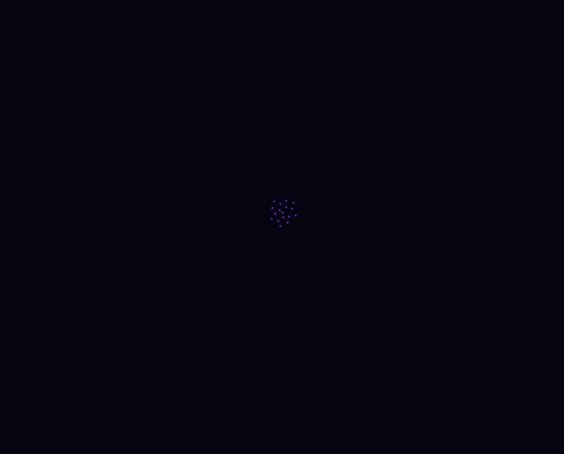

### code therapy for when I'm lost/heartbroken/stressed or MANIC !
 
&nbsp;
 

**Dissociate Back to Yourself**

mindless clicking, different sound notes, and drifting particles make it perfect to zone out and think

 
 

**Bibbidi-bobbidi-boo** ✨ `tiny circ` directory

 
 

໑ hypnotic ໑  `Bloom` directory

 
 

**Random — I just love the colorssss** 💜

 
 

You can hide little letters and words behind your design. I highly recommend giving this one a try! Check out the `thatGreenCalmingthing` directory.

 
 

**???**

 
 

This one screams ERROR, and was born from a bug while coding my computer vision assignment. Gorg.

