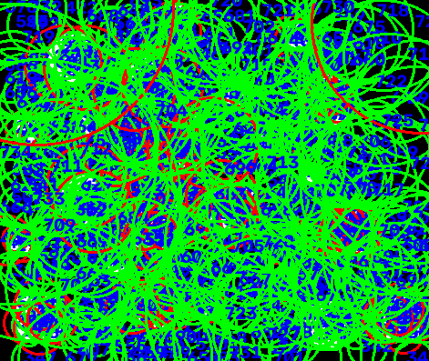

#### A little repository for break times. Simple Python codes, but with results that captivate me. Visuals have such a strong effect on my brain, so... if you're neurodivergent too, you might get it :)))

#### The best part? You code it yourself, so you can instantly change the colors, speed, patterns, and pretty much anything.

 
 

Awesome for zoning out. Kind of ໑ hypnotic ໑ → `Bloom` directory

 

✦
 
✧

 

Bibbidi-bobbidi-boo ✨ `tiny circ` dir

 

✦
 
✧

 

Random — I just love the colorssss 💜

 

✦
 
✧

 

You can hide little letters and words behind your design. I highly recommend giving this one a try! Check out the `thatGreenCalmingthing` directory.

 

✦
 
✧

 

???

 

✦
 
✧

 

this one screams ERROR, and was born from a bug while coding my comp vision assignment. gorg

